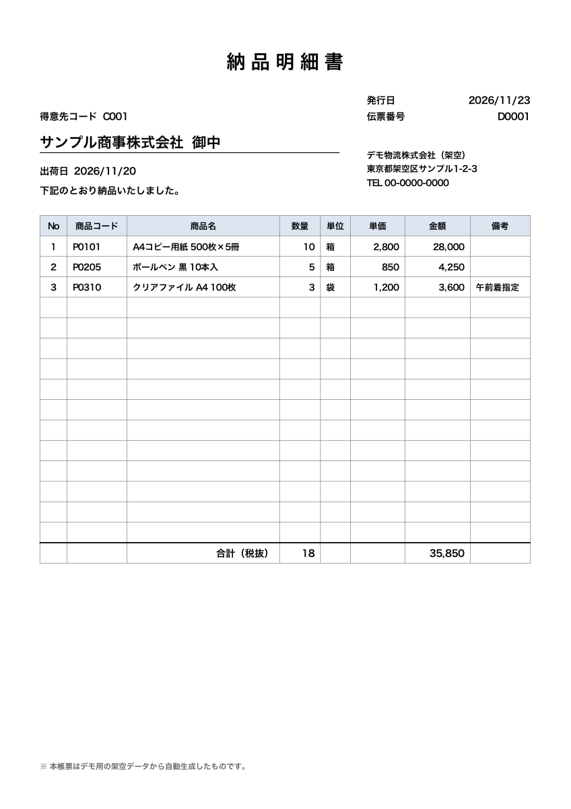
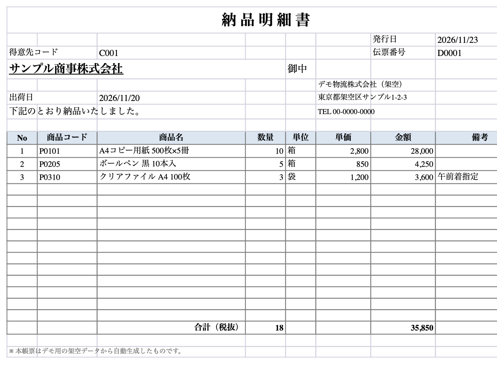

# 出荷CSV → 納品明細 自動作成ツール

出荷データのCSVから、**納品明細のExcelとPDFを伝票ごとに自動で作る** Python ツールです。
入力ミスのある行は**勝手に直さず「要確認一覧」に出し、その伝票は出力しない**ので、間違った納品明細が取引先に届くのを防ぎます。

> 本リポジトリは業務自動化のデモです。データ・会社名・住所はすべて架空です。

| 納品明細（PDF） | 納品明細（Excel・既存テンプレートに流し込み） |
|---|---|
|  |  |

---

## こんな作業を自動化します

| これまで | このツールを使うと |
|---|---|
| 出荷CSVを見ながら、Excelの納品書に1件ずつ手で転記 | CSVを選ぶだけで、伝票ごとのExcelとPDFができる |
| 転記ミスや数量の打ち間違いに、取引先から指摘されて気づく | 欠損・数量の誤り・ID重複を出力前に自動で検出する |
| 毎月の書式の微調整に時間がかかる | いつものExcel書式（テンプレート）に流し込める |

## 安心して使える設計

- **自動で直さない**：問題のある行は修正せず、理由つきで「要確認一覧.xlsx」に出します。
- **明細が欠けた伝票を作らない**：1行でも問題がある伝票は、伝票ごと出力を保留します。伝票番号が空欄の行があれば、その前後の伝票も念のため保留します。
- **帳票からはみ出さない**：長い商品名や大きな金額は文字を縮めて収め、それでも収まらない伝票は要確認に回します。
- **元データを変更しない**：入力CSVは読み取るだけです（テストで変更がないことを確認しています）。
- **上書きしない**：結果は実行するたびに新しい日時フォルダへ出力します。
- **外部に送信しない**：処理はすべてお使いのMacの中だけで行います。インターネットやAIサービスへの送信はありません。
- **Excel由来のCSVにも対応**：文字コード UTF-8 と Shift_JIS を自動判別します。
- **不正な数式を実行させない**：`=` で始まる値も文字列として書き込みます（CSVインジェクション対策）。

## デモ：架空データ10行（正常8行・異常2行）での結果

入力：[sample_data/shipments_sample.csv](sample_data/shipments_sample.csv)

```
=== 納品明細 自動生成 処理結果 ===
読み込んだ行: 10行
出力した伝票: 3件
保留した伝票: D0004、D0005
要確認の行  : 3行（要確認一覧.xlsx を確認してください）
```

要確認一覧.xlsx の中身（右側には元の行データがそのまま並びます）：

| CSV行番号 | 明細ID | 伝票番号 | 区分 | 内容 |
|---|---|---|---|---|
| 9 | L0008 | D0004 | 同一伝票内に要確認行あり | 同じ伝票に要確認の行があるため、伝票ごと出力を保留しました |
| 10 | L0009 | D0004 | 数量不正 | 数量「-2」は不正です。1以上の整数（半角）で入力してください |
| 11 | L0010 | D0005 | 必須項目欠損 | 未入力の必須項目: 商品名 |

---

## 使い方（Mac）

### 準備（初回のみ）

1. このページ右上の **Code → Download ZIP** でダウンロードし、ダブルクリックで展開します。
2. フォルダ内の **`セットアップ.command`** をダブルクリックします。
   - 「開発元を検証できないため開けません」などと表示された場合（初回のみ）：
     - **macOS 15（Sequoia）以降**：いったん「完了」で閉じ、**システム設定 → プライバシーとセキュリティ** を開き、下の方にある「“セットアップ.command”は…ブロックされました」の横の **「このまま開く」** を押します。
     - **macOS 14 以前**：ファイルを **右クリック →「開く」→「開く」** を選びます。
   - `実行.command` を初めて開くときも同じ操作が必要です。
   - Python 3 が入っていない場合は、画面の案内に従って「コマンドライン・デベロッパ・ツール」をインストールするか、[python.org](https://www.python.org/downloads/macos/) から Python をインストールしてから、もう一度実行してください。
3. 「セットアップが完了しました」と表示されたら準備完了です。

### 毎回の操作

1. **`実行.command`** をダブルクリックします。
2. **「CSVを選ぶ」** を押して出荷データを選びます（**「サンプルで試す」** なら架空データで動作を確認できます）。
3. 処理が終わると、結果のフォルダが自動で開きます。

```
output/20261123_153000/
├── excel/納品明細_D0001.xlsx …  伝票ごとのExcel
├── pdf/納品明細_D0001.pdf …     伝票ごとのPDF
├── 要確認一覧.xlsx              問題のあった行（なければ「要確認の行はありません」）
└── 処理結果.txt                 件数のまとめ
```

### コマンドで使う場合

```bash
.venv/bin/python -m shipdoc 出荷データ.csv
```

```bash
.venv/bin/python -m shipdoc 出荷データ.csv --output 出力先フォルダ --template 自社テンプレート.xlsx
```

---

## 入力CSVの形式

1行目に次の列名が必要です（列の順番は自由。過不足があると処理を始めずにエラーを表示します）。

| 列名 | 必須 | ルール | 例 |
|---|---|---|---|
| 伝票番号 | ○ | この値ごとに1枚の納品明細になります | D0001 |
| 明細ID | ○ | ファイル全体で重複不可 | L0001 |
| 出荷日 | ○ | `YYYY-MM-DD` または `YYYY/MM/DD`（実在する日付） | 2026-11-20 |
| 得意先コード | | | C001 |
| 得意先名 | ○ | | サンプル商事株式会社 |
| 商品コード | ○ | 先頭の 0 もそのまま保持します | 00123 |
| 商品名 | ○ | | A4コピー用紙 |
| 数量 | ○ | 1以上の整数（半角） | 10 |
| 単位 | | | 箱 |
| 単価 | ○ | 0以上の数値（半角） | 2800 |
| 備考 | | | 午前着指定 |

## チェック内容

| 区分 | どんなときに出るか |
|---|---|
| 必須項目欠損 | 必須の列が空欄（スペースだけの場合も含む） |
| 数量不正 | 0以下・小数・文字・全角数字 |
| 単価不正 / 日付不正 | 数値でない単価、存在しない日付や形式違いの日付 |
| 明細ID重複 | 同じ明細IDが複数行ある（どちらが正しいか判断せず、該当する全行を対象にします） |
| 列数不一致 | 行の値の数が列数と合わない（例：単価に `1,200` と入力され、引用符なしで保存された） |
| 使用できない文字 | 制御文字など、帳票に書けない文字が含まれる |
| ヘッダ不一致 | 同じ伝票番号なのに出荷日・得意先が行ごとに違う |
| 明細行数超過 | 1伝票の明細が帳票の枠（15行）を超える |
| 帳票に収まらない | 文字を最小サイズまで縮めても、商品名・金額などが枠に収まらない |
| 同一伝票内に要確認行あり | 自分の行は正常だが、同じ伝票に問題の行がある（または前後に伝票番号が空欄の行がある）ため保留した |

---

## 御社の書式に合わせるには

帳票は [templates/納品明細テンプレート.xlsx](templates/納品明細テンプレート.xlsx) に値を流し込んで作ります。
普段お使いのExcel書式に差し替え、[src/shipdoc/template_layout.py](src/shipdoc/template_layout.py) のシート名とセル番地（例：`SLIP_NO_CELL = "H3"`）を合わせれば、その書式で出力できます。
なお、Excel読み書きライブラリの仕様上、テンプレート内の図形やテキストボックスは引き継がれません。ロゴなどを入れる場合は個別に対応します。

## フォルダ構成

```
├── セットアップ.command / 実行.command   ダブルクリック用
├── sample_data/   架空の出荷データ
├── templates/     納品明細のExcelテンプレート
├── src/shipdoc/
│   ├── reader.py          CSV読み込み（文字コード判別・列チェック）
│   ├── validator.py       行ごとのチェック
│   ├── grouper.py         伝票ごとの整理と保留判定
│   ├── excel_writer.py    テンプレートへの流し込み
│   ├── pdf_writer.py      PDF作成
│   ├── review_writer.py   要確認一覧の作成
│   ├── app.py / cli.py    全体の流れ・コマンド
│   └── template_layout.py テンプレートのセル対応表
├── tests/         自動テスト
└── docs/          設計書・実装計画・画像
```

## 開発者向け

```bash
python3 -m venv .venv
```

```bash
.venv/bin/pip install -r requirements.txt -e .
```

```bash
.venv/bin/pytest -v
```

- 使用ライブラリ：[openpyxl](https://openpyxl.readthedocs.io/)（Excel）、[reportlab](https://www.reportlab.com/)（PDF。標準の日本語フォントを使うため、フォントの追加インストールは不要）、pytest / pypdf（テスト）
- 対応 Python：3.9 以上（Mac標準の Python 3.9 でも動作確認済み）
- テンプレートの作り直し：`.venv/bin/python scripts/make_template.py`
- 設計の考え方：[docs/superpowers/specs/](docs/superpowers/specs/)

## 今回の範囲と今後の拡張

デモとして、入力CSVと帳票はそれぞれ1形式に絞っています。実案件では次のような拡張に対応できます。

- 消費税の計算（税率ごとの集計・端数処理のルール設定）
- 15行を超える伝票の複数ページ出力
- 複数の取引先ごとの書式の切り替え、販売管理システムのCSV形式への対応
- 定時の自動実行、出力したPDFのメール送付準備
